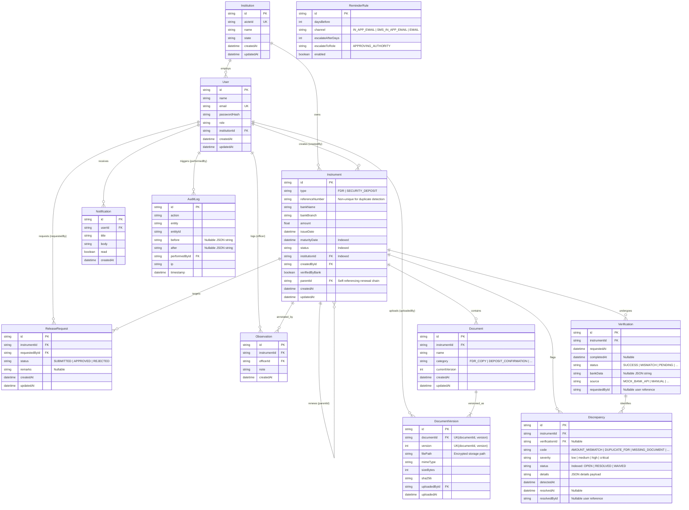

# Entity-Relationship Diagram (ERD) - AICTE FDR Portal

## Architecture Overview
The database schema is designed for SQLite compatibility (enums stored as validated strings, structured payloads as JSON strings).

Key architectural tenets:
1. **Logical Document vs Physical Versioning**: `Document` holds metadata and logical state, while immutable physical file uploads and checksums reside in `DocumentVersion` (with unique `(documentId, version)` constraint).
2. **One-to-Many Bank Verifications**: `Verification` records every verification attempt, source adapter (`MOCK_BANK_API`, `MANUAL`), and confirmed banking payload.
3. **Discrepancy as Single Source of Truth**: `Discrepancy` tracks all amount mismatches, duplicate FDR detection, missing documents, and resolution audit trails with an optional link to `Verification`.
4. **Performance Indexes**: Strategic indexes on high-frequency query fields: `Instrument(status)`, `Instrument(maturityDate)`, `Instrument(institutionId)`, and `Discrepancy(status)`.

---

